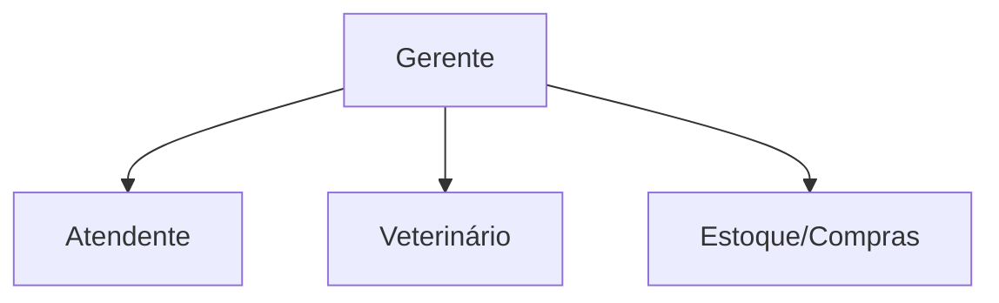

# ETAPA 1 — CARACTERIZAÇÃO DA ORGANIZAÇÃO

> **Sistema:** PataFácil — Gestão integrada para Pet Shop e Clínica Veterinária
> **Finalidade:** Conteúdo-base para o capítulo correspondente do PIM IV (formato ABNT)
>
> *Nota: os dados da empresa são uma caracterização do estudo de caso utilizada
> no PIM. Substitua os nomes e informações pelos dados reais da organização
> escolhida no seu PIM III.*

---

## 1.1 Apresentação da empresa

A **PataFácil** é um estabelecimento do ramo de **cuidados com animais de
estimação**, que atua como pet shop e clínica veterinária de pequeno/médio
porte. Fundada com a proposta de oferecer atendimento completo para cães,
gatos, aves e outros animais, a empresa combina **serviços de estética e bem-
estar** (banho, tosa e acessórios) com **serviços clínicos veterinários**
(consultas, vacinas e exames).

A organização está instalada em uma região urbana de classe média, atendendo
tutores que buscam praticidade e qualidade no cuidado com seus pets. Sua
estrutura é enxuta, contando com atendentes, veterinários e um gerente,
apoiados por rotinas operacionais ainda realizadas de forma predominantemente
manual.

## 1.2 Segmento de atuação

- **Setor:** comércio e serviços voltados a animais de estimação
  (*pet care*);
- **Segmento:** varejo de produtos pet + prestação de serviços veterinários
  e estéticos;
- **Público atendido:** tutores de cães, gatos, aves e outros animais de
  companhia;
- **Porte:** micro/pequena empresa (estrutura de 1 loja).

## 1.3 Produtos e serviços

### Serviços
| Serviço | Descrição | Duração típica |
|---|---|---|
| **Banho e Tosa** | Banho completo, higienização e tosa estética/higiênica | 60 min |
| **Consulta Veterinária** | Avaliação clínica, diagnóstico e orientação | 30 min |
| **Vacina V10** | Aplicação de vacina polivalente para cães | 15 min |
| **Exames e acompanhamento** | Procedimentos clínicos complementares | variável |

### Produtos (venda no balcão)
- **Rações** (linhas econômica e premium);
- **Medicamentos** (antipulgas, vermífugos e prescritos);
- **Produtos de higiene** (shampoos, condicionadores, lenços);
- **Acessórios** (coleiras, brinquedos, camas e comedouros).

## 1.4 Estrutura organizacional

A organização possui uma estrutura **funcional e enxuta**, com papéis bem
definidos:

| Cargo | Responsabilidades |
|---|---|
| **Gerente** | Administração geral, metas, relatórios, contratações e decisões estratégicas |
| **Atendente** | Atendimento ao balcão, agenda, vendas e check-in de serviços |
| **Veterinário** | Consultas, vacinas, exames e registro de prontuários |
| **Apoio (Estoque/Compras)** | Recebimento de mercadorias, reposição e organização do estoque |

## 1.5 Principais processos

1. **Agendamento de serviços:** o tutor solicita o serviço (presencial ou por
   telefone) e a equipe consulta a agenda manual para encaixar o horário;
2. **Atendimento clínico:** o veterinário realiza a consulta e registra as
   informações do animal em prontuário físico;
3. **Venda no balcão:** o atendente registra a venda de produtos, muitas vezes
   sem controle integrado com o estoque;
4. **Reposição de estoque:** o responsável confere as prateleiras e solicita
   compras quando percebe falta;
5. **Fechamento financeiro:** ao final do dia, o gerente soma as vendas
   manualmente para acompanhar o resultado.

## 1.6 Problemas identificados

- **Agenda manual:** risco constante de **choque de horários** entre serviços
  do mesmo profissional, gerando atrasos e perda de receita;
- **Faltas não previstas:** tutores que não comparecem (*no-show*) sem qualquer
  previsão, ocioso o horário reservado;
- **Controle de estoque deficiente:** produtos esgotam sem aviso prévio e as
  vendas **não baixam o estoque automaticamente**;
- **Prontuário em papel:** histórico clínico do pet (vacinas, exames,
  prescrições) disperso e de difícil consulta;
- **Atendimento limitado:** o tutor depende de telefone/balcão para agendar ou
  acompanhar serviços, sem autonomia digital;
- **Gestão sem dados:** ausência de indicadores (receita, ticket médio, demanda)
  para apoiar decisões gerenciais.

## 1.7 Oportunidades de melhoria por meio da tecnologia

- **Automação da agenda:** um sistema que **impeça automaticamente** conflitos
  de horário e calcule a duração de cada serviço;
- **Canal digital para o cliente:** portal e aplicativo mobile que permitam ao
  tutor **agendar, acompanhar e cancelar** serviços online;
- **Histórico clínico digital:** prontuário eletrônico acessível, com
  lembretes de vacinas;
- **Estoque integrado às vendas:** baixa automática e **alertas de reposição**
  no ponto de segurança;
- **Inteligência artificial:** previsão de **demanda diária** e **risco de
  cancelamento**, ajudando a montar a agenda e reduzir faltas;
- **Gestão orientada a dados:** relatórios financeiros e **KPIs em tempo real**
  para o gerente.

Essas oportunidades fundamentam o **Planejamento da Solução Tecnológica**
(capítulo Etapa 2), que propõe o sistema **PataFácil** para digitalizar e
integrar os processos descritos.

---

> **Uso na monografia:** este conteúdo corresponde ao capítulo "Caracterização
> da Organização" do desenvolvimento do PIM IV. Preencha com os dados reais da
> empresa do seu estudo e adicione as referências ABNT.
