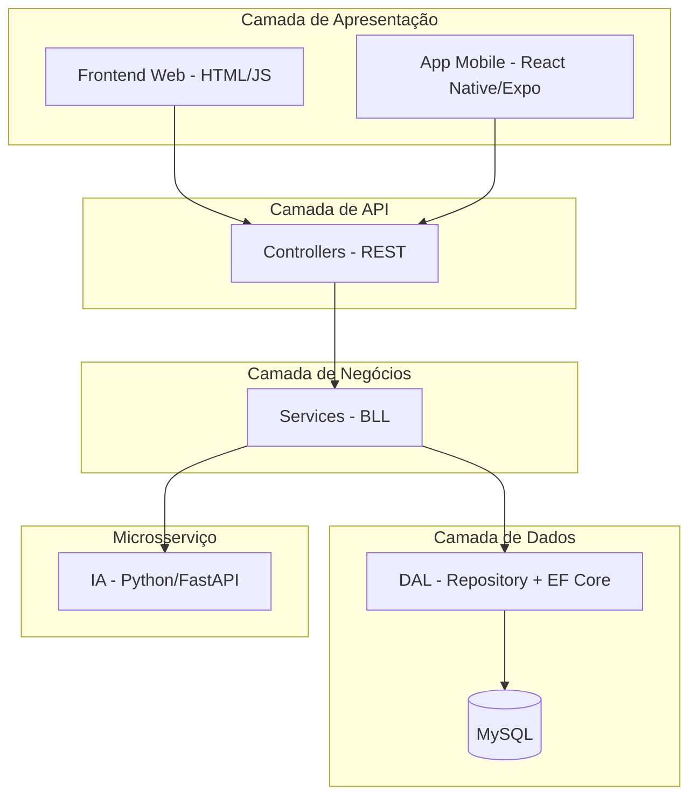
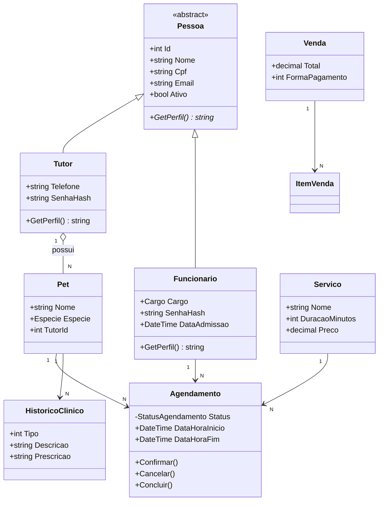

# ETAPA 6 — ARQUITETURA DE SOFTWARE

> **Disciplina:** Programação Aplicada em .NET
> **Sistema:** PataFácil — Gestão integrada para Pet Shop e Clínica Veterinária
> **Finalidade:** Conteúdo-base para o capítulo correspondente do PIM IV (formato ABNT)

---

## 6.1 Visão geral da arquitetura

A arquitetura do PataFácil foi projetada para ser **modular, orientada a
objetos e organizada em camadas**, alinhando o desenvolvimento das aplicações
**Web** e **Mobile** em torno de um **núcleo de APIs REST** compartilhado.



- **Web e Mobile** consomem as **mesmas APIs REST**, garantindo consistência de
  regras de negócio e de dados entre os canais;
- As camadas são **fracamente acopladas**: a apresentação não acessa o banco
  diretamente, e o negócio não depende da tecnologia de interface.

---

## 6.2 Orientação a Objetos

A solução aplica os quatro pilares da Orientação a Objetos:

### 6.2.1 Abstração
A classe base **`Pessoa`** (abstrata) centraliza os atributos comuns de todos
os usuários do sistema (Id, Nome, Cpf, Email, Ativo), servindo como modelo
geral para as entidades que representam pessoas:

```csharp
public abstract class Pessoa
{
    public int Id { get; set; }
    public string Nome { get; set; } = string.Empty;
    public string Cpf { get; set; } = string.Empty;
    public string Email { get; set; } = string.Empty;
    public bool Ativo { get; set; } = true;

    public abstract string GetPerfil();
}
```

### 6.2.2 Herança
As classes **`Tutor`** e **`Funcionario`** herdam de `Pessoa`, reutilizando os
atributos comuns e adicionando suas particularidades:

```csharp
public class Tutor : Pessoa
{
    public string Telefone { get; set; } = string.Empty;
    public string Logradouro { get; set; } = string.Empty;
    // ... endereço, CEP ...
    public string SenhaHash { get; set; } = string.Empty;
}

public class Funcionario : Pessoa
{
    public Cargo Cargo { get; set; }          // Veterinario, Atendente, Gerente
    public string SenhaHash { get; set; } = string.Empty;
    public DateTime DataAdmissao { get; set; }
}
```

### 6.2.3 Polimorfismo
O método abstrato **`GetPerfil()`** é sobrescrito em cada subclasse,
devolvendo comportamentos diferentes para o mesmo contrato:

```csharp
// Tutor.cs
public override string GetPerfil() => "Tutor";

// Funcionario.cs
public override string GetPerfil() => Cargo.ToString();
```

Esse recurso permite, por exemplo, que o **JWT** identifique o papel do usuário
(Tutor, Atendente, Veterinário, Gerente) de forma transparente.

### 6.2.4 Encapsulamento
O **`Agendamento`** protege seu atributo `Status` (visibilidade privada de
escrita) e só permite alterá-lo por métodos específicos, garantindo o fluxo da
regra **RN04** (Pendente → Confirmado → Concluído):

```csharp
public class Agendamento
{
    public StatusAgendamento Status { get; private set; } = StatusAgendamento.PENDENTE;

    public void Confirmar()
    {
        if (Status != StatusAgendamento.PENDENTE)
            throw new InvalidOperationException("Apenas pendentes podem ser confirmados.");
        Status = StatusAgendamento.CONFIRMADO;
    }

    public void Cancelar()
    {
        if (Status == StatusAgendamento.CONCLUIDO)
            throw new InvalidOperationException("Concluídos não podem ser cancelados.");
        Status = StatusAgendamento.CANCELADO;
    }

    public void Concluir() { /* ... */ }
}
```

---

## 6.3 Diagrama de classes (núcleo)



---

## 6.4 Organização em camadas

| Camada | Projeto/Pasta | Responsabilidade |
|---|---|---|
| **Apresentação** | `Frontend/` + `Mobile/` | Interfaces Web e Mobile (clientes da API) |
| **API** | `Controllers/` | Rotas REST, autenticação e orquestração |
| **Negócios (BLL)** | `BLL/` | Regras de negócio (agendamento, venda, relatório, e-mail) |
| **Dados (DAL)** | `DAL/` | Acesso ao banco via Padrão Repository + EF Core |
| **Modelos** | `Models/` | Entidades e enums do domínio |
| **IA (microsserviço)** | `MachineLearning/` | Previsões (cancelamento, demanda, segmentação) |

**Fluxo de uma requisição:** o Controller recebe a requisição HTTP → chama o
**Service** (BLL) → que usa o **Repository** (DAL) → que persiste no **MySQL**.
Nenhuma camada pula a anterior.

---

## 6.5 Modularização

- **Por módulo de negócio:** cada domínio tem seu par Controller/Service
  (Agendamento, Venda, Estoque, Histórico Clínico, Relatório, Autenticação,
  etc.), facilitando a localização e manutenção do código;
- **Por responsabilidade:** a separação física em pastas (`Controllers`,
  `BLL`, `DAL`, `Models`) reflete a separação lógica de responsabilidades;
- **Microsserviço isolado:** a inteligência artificial é um **serviço
  independente** (Python/FastAPI), comunicando-se com o C# via HTTP — pode ser
  evoluída ou escalada separadamente;
- **Reuso:** o **Repository genérico** (`IRepositorio<T>`) elimina código
  repetido de acesso a dados para todas as entidades.

---

## 6.6 Padrões de projeto utilizados

### Padrão Repository (genérico)
Interface única e implementação concreta para persistência, usada por todas as
entidades via **generics**:

```csharp
public interface IRepositorio<T> where T : class
{
    Task<IEnumerable<T>> ObterTodosAsync();
    Task<T?> ObterPorIdAsync(int id);
    Task<int> AdicionarAsync(T entidade);
    Task AtualizarAsync(T entidade);
    Task RemoverAsync(int id);
}
```

### Injeção de Dependência
No `Program.cs`, as dependências são registradas no contêiner e injetadas nos
Controllers/Services, desacoplando as camadas e facilitando testes:

```csharp
builder.Services.AddScoped<AgendamentoService>();
builder.Services.AddScoped(typeof(IRepositorio<>), typeof(Repositorio<>));
builder.Services.AddScoped<IEmailService, EmailService>();
```

### Entity Framework Core (mapeamento objeto-relacional)
O `PataFacilContext` mapeia as entidades C# para as tabelas do MySQL,
dispensando SQL manual nas operações comuns.

---

## 6.7 Alinhamento Web e Mobile

A mesma arquitetura atende aos dois canais:

| Canal | Tecnologia | Consome |
|---|---|---|
| **Web** | HTML/CSS/JS | APIs REST (fetch + JWT) |
| **Mobile** | React Native/Expo | APIs REST (fetch + JWT) |

Ambos:
- se autenticam no **mesmo endpoint** (`/api/auth/login`);
- seguem as **mesmas regras de negócio** validadas no backend (RN01–RN15);
- utilizam o **mesmo banco de dados**, garantindo sincronização dos dados.

> Assim, qualquer evolução de regra no backend (BLL/DAL) beneficia
> simultaneamente a aplicação Web e o aplicativo Mobile.

---

> **Uso na monografia:** este conteúdo corresponde ao capítulo "Arquitetura de
> Software" do desenvolvimento do PIM IV. Complemente com os diagramas gerados
> pelo Visual Studio/ferramentas e as referências ABNT.
