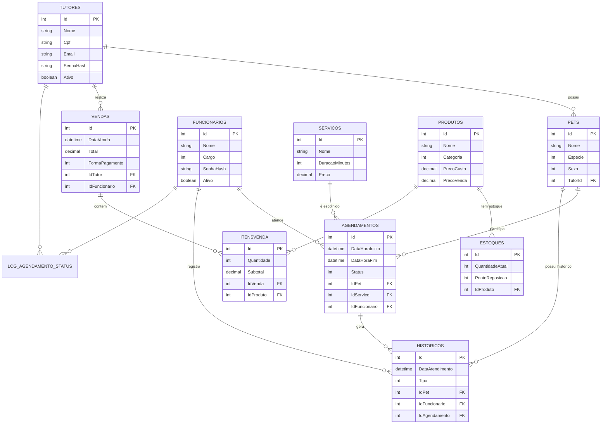

# ETAPA 7 — PROJETO DO BANCO DE DADOS

> **Disciplina:** Programação de Banco de Dados
> **Sistema:** PataFácil — Gestão integrada para Pet Shop e Clínica Veterinária
> **Finalidade:** Conteúdo-base para o capítulo correspondente do PIM IV (formato ABNT)

---

## 7.1 Visão geral

O banco de dados do PataFácil utiliza **MySQL 8**, gerenciado pela aplicação por
meio do **Entity Framework Core** (mapeamento objeto-relacional). O modelo é
composto por **10 tabelas principais**, além de tabelas de apoio (auditoria e
alertas), **5 stored procedures**, **4 triggers**, **2 views** e **5 índices**
adicionais de otimização.

O **script completo** do banco está em
`PataFacil/DAL/ScriptBancoDeDados.sql` e pode ser executado diretamente no MySQL
para recriar toda a estrutura, incluindo procedures, triggers, views e índices.

---

## 7.2 Modelo lógico

O modelo lógico descreve as entidades e os relacionamentos do domínio,
independente do SGBD:

```
TUTOR (1) ───< (N) PET
FUNCIONARIO (1) ───< (N) AGENDAMENTO
SERVICO (1) ───< (N) AGENDAMENTO
PET (1) ───< (N) AGENDAMENTO
PET (1) ───< (N) HISTORICO
FUNCIONARIO (1) ───< (N) HISTORICO
AGENDAMENTO (1) ───< (N) HISTORICO
PRODUTO (1) ───< (N) ESTOQUE
TUTOR (1) ───< (N) VENDA
FUNCIONARIO (1) ───< (N) VENDA
VENDA (1) ───< (N) ITEM_VENDA
PRODUTO (1) ───< (N) ITEM_VENDA
```

### Entidades e atributos

| Entidade | Atributos principais |
|---|---|
| **Tutor** | Id, Nome, Cpf, Email, Telefone, Logradouro, Numero, Bairro, Cidade, Uf, Cep, DataCadastro, SenhaHash, Ativo |
| **Pet** | Id, Nome, Especie, Raca, Sexo, DataNascimento, PesoKg, FotoUrl, Observacoes, Ativo, TutorId *(FK)* |
| **Funcionario** | Id, Nome, Cpf, Email, Cargo, SenhaHash, DataAdmissao, Ativo |
| **Servico** | Id, Nome, Descricao, DuracaoMinutos, Preco, Ativo |
| **Agendamento** | Id, DataHoraInicio, DataHoraFim, Observacoes, DataCriacao, Status, IdPet *(FK)*, IdServico *(FK)*, IdFuncionario *(FK)* |
| **Historico (Clínico)** | Id, DataAtendimento, Tipo, Descricao, Diagnostico, Prescricao, PesoRegistro, ProximaVacina, IdPet *(FK)*, IdFuncionario *(FK)*, IdAgendamento *(FK)* |
| **Produto** | Id, Nome, Descricao, Categoria, Marca, PrecoCusto, PrecoVenda, UnidadeMedida, CodigoBarras, Ativo |
| **Estoque** | Id, QuantidadeAtual, PontoReposicao, QuantidadeReposicao, UltimaAtualizacao, IdProduto *(FK)* |
| **Venda** | Id, DataVenda, Total, FormaPagamento, Observacoes, IdTutor *(FK)*, IdFuncionario *(FK)* |
| **ItemVenda** | Id, Quantidade, PrecoUnitario, Subtotal, IdVenda *(FK)*, IdProduto *(FK)* |

---

## 7.3 Modelo físico (MER)

O **MER** (Modelo Entidade-Relacionamento) abaixo representa as tabelas, as
chaves primárias (PK), as chaves estrangeiras (FK) e os relacionamentos:



> **Convenções:** os enums do C# são representados como `INT` no banco
> (ex.: `Status` 0=Pendente, 1=Confirmado, 2=Concluído, 3=Cancelado; `Cargo`
> 0=Veterinário, 1=Atendente, 2=Gerente). Isso mantém o modelo leve e o
> mapeamento do Entity Framework simplificado.

---

## 7.4 Stored procedures

| Procedure | Descrição | Regras atendidas |
|---|---|---|
| **`sp_agendar_servico`** | Agenda um serviço validando conflito de horário do profissional, expediente (08h–19h) e fechamento aos domingos; calcula o fim pela duração do serviço | RN01, RN03, RN10 |
| **`sp_horarios_disponiveis`** | Retorna os horários livres de um profissional em uma data, considerando a duração do serviço e os agendamentos já existentes (intervalo de 30 min) | RN01, RN10 |
| **`sp_registrar_venda`** | Cria uma venda dentro de transação; a baixa de estoque e o total são atualizados pelos triggers | RN15 |
| **`sp_receita_mensal`** | Gera relatório de receita mensal (total de vendas, receita total e ticket médio) | Apoio gerencial |
| **`sp_estoque_critico`** | Lista produtos com saldo igual ou abaixo do ponto de reposição | RN15 |

**Exemplo de chamada — `sp_agendar_servico` (com validação de RN01/RN03):**

```sql
CALL sp_agendar_servico(
    1,          -- id_pet
    1,          -- id_servico
    1,          -- id_funcionario
    '2026-08-31 09:00:00',  -- data/hora de início
    'Consulta de rotina',   -- observações
    @id_agendamento,        -- OUT: id criado (0 se bloqueado)
    @mensagem               -- OUT: mensagem de sucesso ou regra violada
);
SELECT @id_agendamento, @mensagem;
```

---

## 7.5 Triggers

| Trigger | Evento | Descrição | Regra |
|---|---|---|---|
| **`trg_agendamento_calcula_fim`** | BEFORE INSERT em `agendamentos` | Calcula `DataHoraFim` automaticamente a partir da duração do serviço | RN10 |
| **`trg_item_venda_baixa_estoque`** | AFTER INSERT em `itensvenda` | Baixa o estoque do produto vendido e gera alerta de reposição | RN15 |
| **`trg_item_venda_atualiza_total`** | AFTER INSERT em `itensvenda` | Recalcula o `Total` da venda somando os subtotais dos itens | Consistência |
| **`trg_agendamento_log_status`** | AFTER UPDATE em `agendamentos` | Grava em `log_agendamento_status` toda mudança de status (auditoria) | RN04 |

**Exemplo — trigger de baixa de estoque (RN15):**

```sql
CREATE TRIGGER trg_item_venda_baixa_estoque
AFTER INSERT ON itensvenda
FOR EACH ROW
BEGIN
    UPDATE estoques
    SET QuantidadeAtual = QuantidadeAtual - NEW.Quantidade,
        UltimaAtualizacao = CURRENT_TIMESTAMP
    WHERE IdProduto = NEW.IdProduto;

    -- Se atingiu o ponto de reposição, dispara o alerta
    INSERT INTO alerta_reposicao (IdProduto, QuantidadeAtual, PontoReposicao)
    SELECT IdProduto, QuantidadeAtual, PontoReposicao
    FROM estoques
    WHERE IdProduto = NEW.IdProduto
      AND QuantidadeAtual <= PontoReposicao;
END;
```

---

## 7.6 Views

| View | Descrição |
|---|---|
| **`vw_estoque_critico`** | Produtos com saldo igual ou abaixo do ponto de reposição (alerta de reposição — RN15) |
| **`vw_receita_por_servico`** | Receita estimada por serviço, contando atendimentos Confirmados/Concluídos |

---

## 7.7 Tabelas de apoio

| Tabela | Finalidade |
|---|---|
| **`log_agendamento_status`** | Auditoria das mudanças de status do agendamento (RN04) |
| **`alerta_reposicao`** | Registro dos alertas automáticos de reposição de estoque (RN15) |

---

## 7.8 Índices de otimização

| Índice | Tabela | Finalidade |
|---|---|---|
| `idx_agendamentos_funcionario_horario` | `agendamentos` | Acelera a checagem de conflito de horário (RN01) |
| `idx_agendamentos_status` | `agendamentos` | Filtros por status |
| `idx_agendamentos_data` | `agendamentos` | Consultas por data (agenda do dia/semana) |
| `idx_vendas_data` | `vendas` | Relatórios mensais |
| `idx_historicos_pet` | `historicos` | Histórico clínico por pet |
| `idx_itensvenda_produto` | `itensvenda` | Agregação por produto |

---

## 7.9 Resultados dos testes executados

O script foi executado e validado em um banco MySQL 8 real. Resultados obtidos:

| Teste | Resultado |
|---|---|
| Agendamento válido | ✅ Criado com sucesso |
| Conflito de horário (RN01) | ✅ Bloqueado ("Conflito de horário com outro atendimento") |
| Agendamento aos domingos (RN03) | ✅ Bloqueado ("Fechado aos domingos") |
| Horários disponíveis | ✅ Retorna apenas horários livres |
| Trigger calcula fim (RN10) | ✅ 10:00 → 10:30 (serviço de 30 min) |
| Auditoria de status (RN04) | ✅ Registro 0→1 gravado no log |
| Baixa de estoque (RN15) | ✅ Estoque 5→3 e alerta gerado |
| Total automático da venda | ✅ R$ 335,00 (soma dos itens) |
| Relatório de receita mensal | ✅ Retorna vendas, total e ticket médio |
| View de estoque crítico | ✅ Lista produto abaixo do ponto de reposição |

---

> **Uso na monografia:** este conteúdo corresponde ao capítulo "Projeto do Banco
> de Dados" do desenvolvimento do PIM IV. Inclua também o script completo
> (`ScriptBancoDeDados.sql`) como anexo, conforme o manual solicita o "Script do
> Banco de dados completo".
