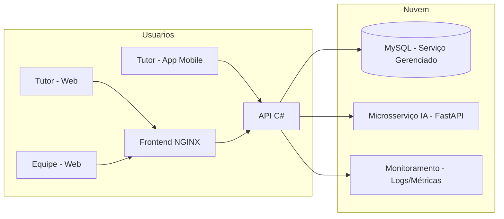
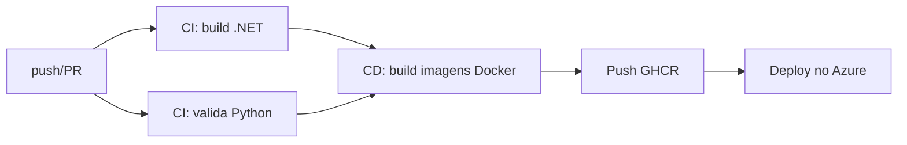

# ETAPA 8 — INFRAESTRUTURA EM NUVEM E DEVOPS

> **Disciplina:** EAD — Cloud Computing e DevOps
> **Sistema:** PataFácil — Gestão integrada para Pet Shop e Clínica Veterinária
> **Finalidade:** Conteúdo-base para o capítulo correspondente do PIM IV (formato ABNT)

---

## 8.1 Visão geral

A solução PataFácil foi projetada para ser executada em **containers
(Docker)**, seguindo as boas práticas de **DevOps** e **Cloud Computing**.
O plano abaixo descreve a arquitetura em nuvem, os serviços utilizados, o
pipeline de CI/CD, o monitoramento, a escalabilidade e a segurança.

Os arquivos de infraestrutura criados no projeto:

| Arquivo | Finalidade |
|---|---|
| `DevOps/Dockerfile.api` | Imagem da API C# (multi-estágio) |
| `DevOps/Dockerfile.ml` | Imagem do microsserviço de IA (Python) |
| `DevOps/docker-compose.yml` | Orquestração local: db + ml-api + api + frontend |
| `DevOps/nginx.conf` | Servidor web do frontend estático |
| `.github/workflows/ci.yml` | Pipeline CI/CD (GitHub Actions) |
| `MachineLearning/requirements.txt` | Dependências do microsserviço Python |

---

## 8.2 Arquitetura em nuvem

A arquitetura proposta é **modular e baseada em containers**, podendo ser
implantada em provedores como **Microsoft Azure**, **AWS** ou **Google Cloud**.
Segue o desenho de referência (nuvem pública):



**Componentes:**
- **Frontend (NGINX):** serve os arquivos estáticos (HTML/CSS/JS) e pode fazer
  proxy para a API;
- **API C# (ASP.NET Core):** serviços REST, autenticação JWT e regras de negócio;
- **Microsserviço de IA (FastAPI):** previsões de demanda, risco de cancelamento
  e segmentação;
- **Banco de Dados (MySQL):** persistência dos dados do sistema.

---

## 8.3 Serviços utilizados (referência — Microsoft Azure)

| Componente | Serviço Azure | Justificativa |
|---|---|---|
| Frontend estático | **Azure Static Web Apps** | Hospedagem de baixo custo com CDN global |
| API C# | **Azure Container Apps / App Service** | Execução de containers gerenciada |
| Microsserviço IA | **Azure Container Apps** | Escala sob demanda para inferência |
| Banco de dados | **Azure Database for MySQL** | Serviço gerenciado com backup automático |
| Imagens | **Azure Container Registry (ACR)** | Registro privado de imagens Docker |
| CI/CD | **GitHub Actions** | Pipeline de build, teste e deploy |
| Monitoramento | **Azure Monitor + Application Insights** | Métricas, logs e alertas |
| Secretos | **Azure Key Vault** | Armazenamento de chaves e senhas |

> **Alternativa de baixo custo (AWS):** S3 + CloudFront (frontend), ECS Fargate
> (API e IA) e RDS (MySQL).

---

## 8.4 Containers

As aplicações são empacotadas em **imagens Docker** imutáveis, o que garante
reprodutibilidade entre ambientes (dev, teste e produção).

- **`Dockerfile.api`** — build em **dois estágios**: o primeiro compila e
  publica o projeto .NET (`dotnet publish -c Release`), o segundo cria a imagem
  final enxuta com o runtime do ASP.NET Core;
- **`Dockerfile.ml`** — imagem Python que instala as dependências do
  `requirements.txt` e expõe a API FastAPI na porta 8000;
- **`docker-compose.yml`** — sobe toda a stack localmente:
  - `db` (MySQL 8) com healthcheck;
  - `ml-api` (IA);
  - `api` (C#), aguardando o banco ficar saudável;
  - `frontend` (NGINX) servindo a pasta `Frontend/`.

```bash
# Subir toda a solução localmente com um comando
cd DevOps
docker compose up --build
```

> As variáveis de ambiente (conexão com o banco, URL da IA, chave JWT) são
> injetadas por **variáveis de ambiente**, evitando dados sensíveis no código.

---

## 8.5 Pipeline CI/CD

O pipeline foi implementado no **GitHub Actions** (`.github/workflows/ci.yml`)
e está dividido em duas etapas:

### CI (Integração Contínua) — a cada push/PR na `main`
1. **Backend:** compila o projeto .NET em Release (`dotnet build`);
2. **IA:** instala as dependências Python e valida a sintaxe do `ml_api.py`;
3. *(Testes automatizados serão integrados na última etapa do projeto.)*

### CD (Entrega Contínua) — após merge na `main`
1. **Login** no GitHub Container Registry (GHCR);
2. **Build e push** das imagens `patafacil-api` e `patafacil-ml` (com tags
   `latest` e `sha do commit`);
3. *(Deploy automático no Azure Container Apps pode ser adicionado com um
   passo de `azure/webapps-deploy@v3` ou `az acr import`.)*



---

## 8.6 Monitoramento

- **Logs estruturados:** a API .NET utiliza o **ILogger** (ASP.NET Core) e o
  microsserviço Python registra eventos de inicialização e predição;
- **Métricas de negócio:** o dashboard já expõe **KPIs** (receita, ticket
  médio, agendamentos) que servem como indicadores de saúde do negócio;
- **Application Insights (Azure):** coleta requisições, dependências,
  exceções e performance da API;
- **Alertas:** regras de alerta para falha de dependências (ex.: IA fora do ar,
  banco indisponível) e uso elevado de recursos;
- **Healthchecks:** o MySQL possui healthcheck no docker-compose, e a API pode
  expor um endpoint de saúde para o orquestrador.

---

## 8.7 Escalabilidade

- **Horizontal:** a API e o microsserviço de IA são **stateless** (o estado fica
  no banco e no token JWT), permitindo **múltiplas réplicas** atrás de um
  balanceador de carga;
- **Sob demanda:** em Azure Container Apps, a IA pode **escalar para zero**
  quando ociosa e subir automaticamente em horários de pico (economia de custo);
- **Banco:** o Azure Database for MySQL permite aumento de vCPU/armazenamento e
  réplicas de leitura para consultas pesadas (relatórios);
- **Frontend:** arquivos estáticos distribuídos por **CDN**, reduzindo a carga
  no servidor e melhorando a latência.

---

## 8.8 Segurança

- **Segredos:** chave JWT e senha do banco em **Key Vault**/variáveis de
  ambiente, nunca no código-fonte;
- **Rede:** serviços expostos somente pelas portas necessárias; banco acessível
  apenas internamente na rede privada;
- **Autenticação:** Token **JWT com expiração de 8 horas** e senhas com **BCrypt**;
- **Imagens:** builds em camadas com `--no-cache-dir` (Python) e imagens
  `runtime` enxutas (menor superfície de ataque);
- **Contêineres:** princípio do **menor privilégio** (portas mínimas, usuário
  não-root recomendado);
- **TLS/HTTPS:** toda a comunicação externa via HTTPS (Azure Automatic TLS);
- **Backup:** backups automáticos do MySQL gerenciado com retenção configurável.

---

> **Uso na monografia:** este conteúdo corresponde ao capítulo "Infraestrutura
> em Nuvem e DevOps" do desenvolvimento do PIM IV. Adapte a escolha do provedor
> e os nomes dos serviços à sua apresentação e adicione as referências ABNT.
