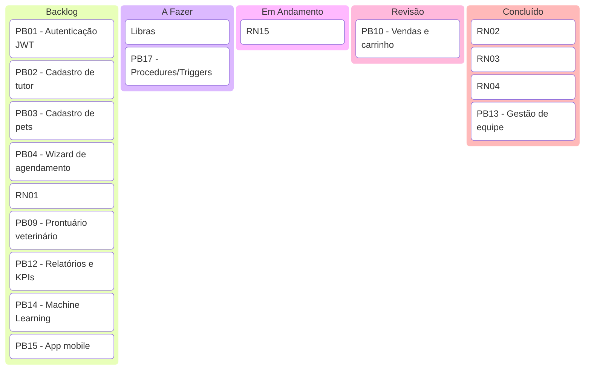

# ETAPA 9 — GERENCIAMENTO ÁGIL DO PROJETO

> **Disciplina:** Gerenciamento de Projetos Ágil (Scrum)
> **Sistema:** PataFácil — Gestão integrada para Pet Shop e Clínica Veterinária
> **Finalidade:** Conteúdo-base para o capítulo correspondente do PIM IV (formato ABNT)

---

## 9.1 Visão geral do método

O projeto PataFácil foi conduzido utilizando a metodologia ágil **Scrum**, com
ciclos iterativos e incrementais chamados **Sprints**. A equipe trabalhou com
papéis bem definidos, um **Product Backlog** priorizado pelo Product Owner, e
reuniões de planejamento, revisão e retrospectiva ao final de cada Sprint.

### Papéis do time
| Papel | Responsabilidade |
|---|---|
| **Product Owner** | Prioriza o backlog, define a visão do produto e valida as entregas |
| **Scrum Master** | Facilita as cerimônias e remove impedimentos do time |
| **Time de Desenvolvimento** | Implementa as histórias: backend C#, frontend web, mobile, banco e IA |

### Cerimônias
- **Sprint Planning:** definição do objetivo e do Sprint Backlog;
- **Daily Scrum:** reunião diária de 15 minutos (o que fez, o que fará, impedimentos);
- **Sprint Review:** demonstração das entregas ao Product Owner;
- **Sprint Retrospective:** melhoria contínua do processo.

---

## 9.2 Product Backlog

O Product Backlog reúne todas as funcionalidades do sistema, priorizadas por
valor de negócio. Cada item é descrito no formato de **história de usuário**:
"Como **[papel]**, quero **[funcionalidade]**, para **[benefício]**".

| # | Prioridade | História de Usuário | Critérios principais |
|---|---|---|---|
| PB01 | 1 | Como **usuário**, quero **me autenticar no sistema**, para **acessar meu painel com segurança**. | JWT, senha criptografada (BCrypt), expiração de 8h |
| PB02 | 1 | Como **tutor**, quero **me cadastrar**, para **criar minha conta** no sistema. | CPF válido, e-mail único |
| PB03 | 1 | Como **tutor**, quero **cadastrar meus pets**, para **agendar serviços para eles**. | Espécie, sexo, peso e nascimento |
| PB04 | 2 | Como **tutor**, quero **agendar serviços**, para **reservar horário sem ligar**. | Wizard: pet → serviço → profissional → horário |
| PB05 | 2 | Como **sistema**, quero **impedir conflito de horário** do profissional (RN01), para **não marcar dois serviços ao mesmo tempo**. | Validação de sobreposição |
| PB06 | 2 | Como **tutor**, quero **cancelar online**, para **desmarcar com antecedência** (RN02). | Antecedência mínima de 2h |
| PB07 | 2 | Como **sistema**, quero **limitar o agendamento** ao expediente (08h–19h, exceto domingo) (RN03), para **respeitar o horário de funcionamento**. | Validação de dia/hora |
| PB08 | 3 | Como **sistema**, quero **controlar o fluxo do status** (Pendente→Confirmado→Concluído) (RN04), para **evitar inversões de etapa**. | Encapsulamento do status |
| PB09 | 3 | Como **veterinário**, quero **registrar prontuários**, para **manter o histórico clínico do pet**. | Consulta, vacina, exame, prescrição |
| PB10 | 4 | Como **atendente**, quero **gerenciar vendas e estoque**, para **controlar o inventário**. | Carrinho de venda |
| PB11 | 4 | Como **sistema**, quero **baixar o estoque automaticamente a cada venda** (RN15), para **nunca vender o que não tem**. | Trigger de baixa + alerta de reposição |
| PB12 | 5 | Como **gerente**, quero **ver relatórios e KPIs**, para **decidir com base em dados**. | Receita mensal, ticket médio, dashboard |
| PB13 | 5 | Como **gerente**, quero **cadastrar a equipe**, para **gerenciar os acessos**. | CRUD de funcionários (perfil Gerente) |
| PB14 | 6 | Como **gerente**, quero **prever demanda e risco de cancelamento**, para **otimizar a agenda**. | API Python (Random Forest, Regressão, K-Means) |
| PB15 | 6 | Como **tutor**, quero **usar o aplicativo mobile**, para **agendar de qualquer lugar**. | App React Native/Expo integrado às APIs |
| PB16 | 7 | Como **pessoa surda**, quero **usar Libras no sistema**, para **acessar os serviços de forma inclusiva**. | Plugin VLibras + acessibilidade |
| PB17 | 7 | Como **equipe de dados**, quero **procedures e triggers no banco**, para **garantir integridade e desempenho**. | Script completo do banco |

---

## 9.3 Sprint Backlog e cronograma das Sprints

O projeto foi dividido em **6 Sprints de 2 semanas** (12 semanas no total),
cada uma com objetivo e entregas claras.

### Sprint 1 — Fundação e Autenticação
**Objetivo:** criar a base do sistema (banco, API e login).
- Estrutura em camadas (Controllers, BLL, DAL, Models) e Padrão Repository
- Banco de dados MySQL + Entity Framework Core
- Autenticação JWT e cadastro de tutor (PB01, PB02)
- **Entrega:** login funcional com perfis de acesso

### Sprint 2 — Cadastro de Pets e Agenda
**Objetivo:** permitir cadastrar pets e agendar serviços.
- Cadastro e listagem de pets (PB03)
- Wizard de agendamento (PB04)
- Regras RN01 (conflito), RN03 (expediente) e RN10 (duração) (PB05, PB07)
- **Entrega:** agendamento funcional sem choque de horários

### Sprint 3 — Fluxo Clínico
**Objetivo:** completar o ciclo do agendamento e a área clínica.
- Fluxo de status travado RN04 (PB08)
- Prontuário e histórico clínico (PB09)
- Cancelamento com antecedência RN02 (PB06)
- **Entrega:** atendimento clínico completo (Pendente→Confirmado→Concluído)

### Sprint 4 — Estoque e Vendas
**Objetivo:** integrar vendas ao estoque.
- Gestão de produtos e estoque (PB10)
- Venda com carrinho e baixa automática RN15 (PB11)
- Alertas de ponto de reposição
- **Entrega:** venda reduzindo o estoque e alertando reposição

### Sprint 5 — Gestão e Relatórios
**Objetivo:** apoiar a tomada de decisão gerencial.
- Relatórios de receita mensal e KPIs (PB12)
- Gestão de equipe (PB13)
- Dashboard gerencial
- **Entrega:** painel do gerente com indicadores em tempo real

### Sprint 6 — Inteligência Artificial, Mobile e DevOps
**Objetivo:** diferenciais e canais adicionais.
- API de Machine Learning (PB14)
- Aplicativo mobile (PB15)
- Acessibilidade e Libras (PB16)
- Procedures/triggers e otimização do banco (PB17)
- **Entrega:** sistema completo (web + mobile + IA + banco otimizado)

### Cronograma resumido
| Sprint | Período (exemplo) | Foco | Status |
|---|---|---|---|
| Sprint 1 | Semana 1–2 | Fundação e autenticação | ✅ |
| Sprint 2 | Semana 3–4 | Pets e agenda | ✅ |
| Sprint 3 | Semana 5–6 | Fluxo clínico | ✅ |
| Sprint 4 | Semana 7–8 | Estoque e vendas | ✅ |
| Sprint 5 | Semana 9–10 | Gestão e relatórios | ✅ |
| Sprint 6 | Semana 11–12 | IA, Mobile e DevOps | ✅ |

---

## 9.4 Quadro Kanban

O quadro Kanban organiza o trabalho em colunas de fluxo, permitindo visualizar o
progresso das Sprints e identificar gargalos.

> **Leitura:** no quadro de exemplo, as histórias do backlog são priorizadas; as
> que estão em "Em Andamento"/"Revisão" refletem o fluxo do Sprint atual, e as
> "Concluídas" representam entregas já validadas.

---

## 9.5 Definição de Pronto (Definition of Done)

Uma história só é considerada **pronta** quando atende a todos os critérios:

1. Código implementado e **compilando sem erros**;
2. **Regras de negócio** envolvidas validadas (RN01–RN15);
3. **Integração** com a API e o banco de dados funcionando;
4. **Interface** (web ou mobile) operando de ponta a ponta;
5. **Documentação** atualizada (código comentado + manuais);
6. **Testes** executados sem falhas (quando aplicável);
7. Revisão pelo Product Owner na **Sprint Review**.

---

## 9.6 Definição das entregas por incremento

| Incremento | Entregável |
|---|---|
| **Sprint 1** | API base com autenticação JWT e cadastro de tutor |
| **Sprint 2** | Módulo de pets e agendamento com regras RN01/RN03/RN10 |
| **Sprint 3** | Ciclo clínico completo (prontuário + fluxo de status RN04) |
| **Sprint 4** | Estoque integrado às vendas com alerta RN15 |
| **Sprint 5** | Painel gerencial com relatórios e KPIs |
| **Sprint 6** | Solução integrada: web + mobile + IA + banco otimizado |

Cada Sprint entrega um **incremento utilizável**, seguindo o princípio ágil de
entregar valor de forma contínua e validar o produto com o cliente ao longo do
desenvolvimento.

---

> **Uso na monografia:** este conteúdo corresponde ao capítulo "Gerenciamento
> Ágil do Projeto" do desenvolvimento do PIM IV. Adapte os nomes, datas e
> tamanho da equipe à sua realidade e adicione as referências ABNT.
