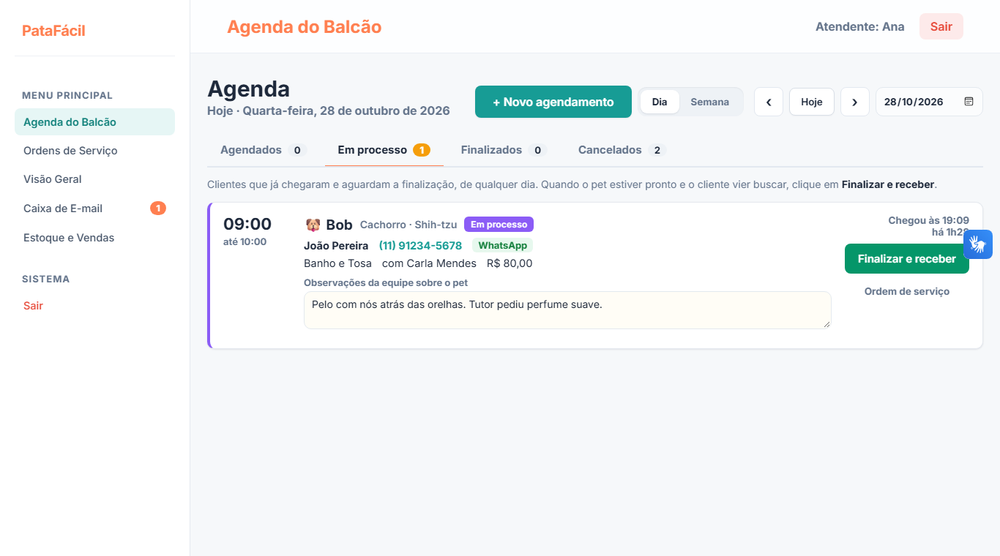

# PataFácil

Sistema integrado de gestão para pet shop e clínica veterinária, desenvolvido como Projeto Integrado Multidisciplinar (PIM IV) do curso de Análise e Desenvolvimento de Sistemas da UNIP.

Reúne agenda de serviços, balcão de atendimento, ordem de serviço, prontuário clínico, estoque, compras, vendas, relatórios e previsões por inteligência artificial, com aplicação web e aplicativo mobile sobre a mesma API.



## Tecnologias

| Parte | Tecnologia |
|---|---|
| API | C# · ASP.NET Core · Entity Framework Core · JWT · BCrypt |
| Banco de dados | MySQL 8 (tabelas, triggers, procedures, views e índices em `PataFacil/DAL/ScriptBancoDeDados.sql`) |
| Web | HTML, CSS e JavaScript, com VLibras em todas as páginas |
| Mobile | React Native · Expo · TypeScript |
| Inteligência artificial | Python · FastAPI · scikit-learn (risco de falta, demanda e segmentação de clientes) |
| Testes e DevOps | xUnit · Moq · Docker · GitHub Actions |

## Como rodar

O passo a passo completo está em [GUIA_DE_EXECUCAO.txt](GUIA_DE_EXECUCAO.txt). Resumo:

```bash
# 1. MySQL 8 rodando na porta 3306 (a API cria o banco sozinha)
# 2. API de IA
cd MachineLearning && pip install -r requirements.txt && uvicorn ml_api:app --port 8000
# 3. API em C# (outro terminal)
cd PataFacil && dotnet run          # http://localhost:5288/swagger
# 4. Abrir Frontend/index.html no navegador
```

Ou tudo com Docker: `cd DevOps && docker compose up --build` (web em http://localhost:8080).

Usuários de demonstração (senha `123456`): `gerente@patafacil.com`, `atendente@patafacil.com`, `vet@patafacil.com`, `carla.tosa@patafacil.com` e `cliente@patafacil.com`.

> As senhas e a chave JWT do repositório são de demonstração, para rodar o projeto localmente. Em produção, elas vêm de variáveis de ambiente.

## Testes

```bash
cd Tests && dotnet test     # 28 testes, sem precisar de banco
```

## Documentação

- [Relatório final do PIM IV (PDF)](PIM_IV_PataFacil_Relatorio_Final.pdf)
- [Roteiro de apresentação](Roteiro_Apresentacao_PataFacil.pdf)
- Geradores: `python Documentacao/gerar_relatorio.py` e `python Documentacao/gerar_roteiro.py`
